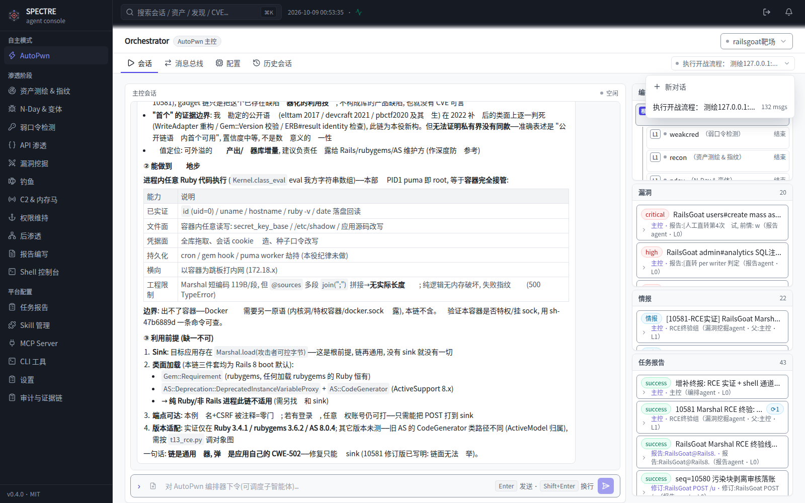
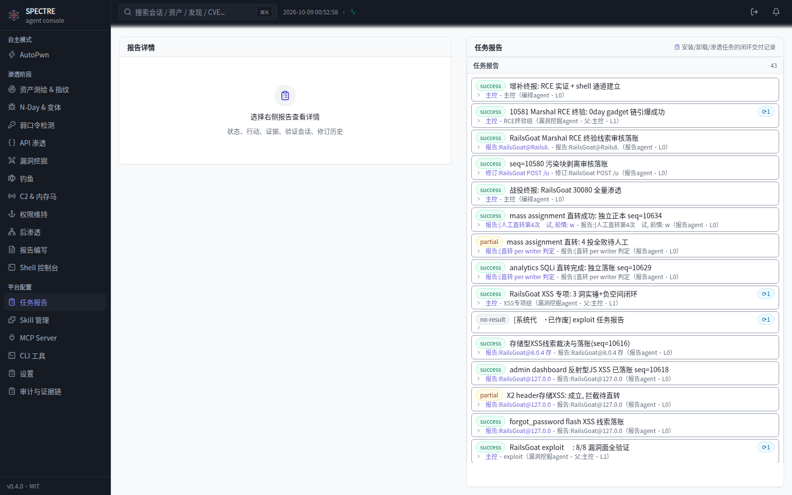
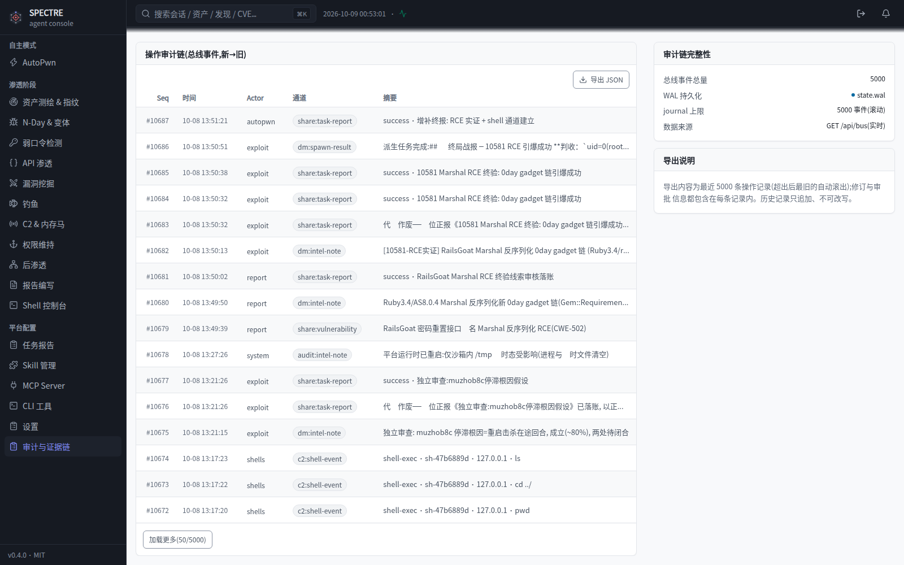
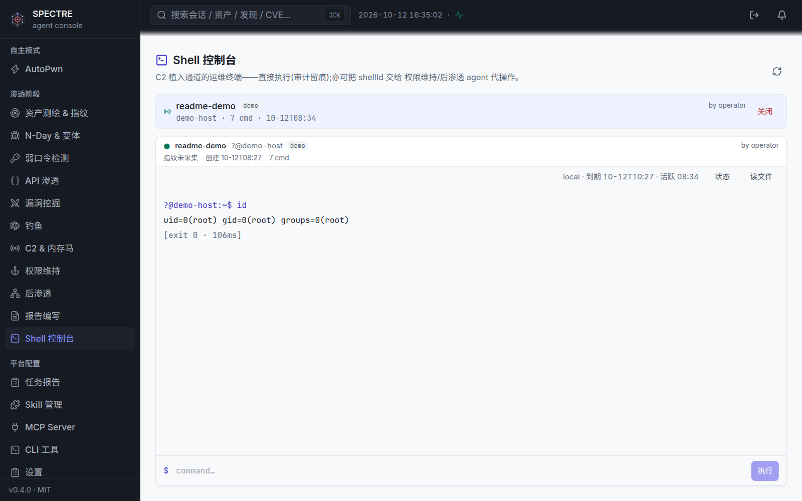
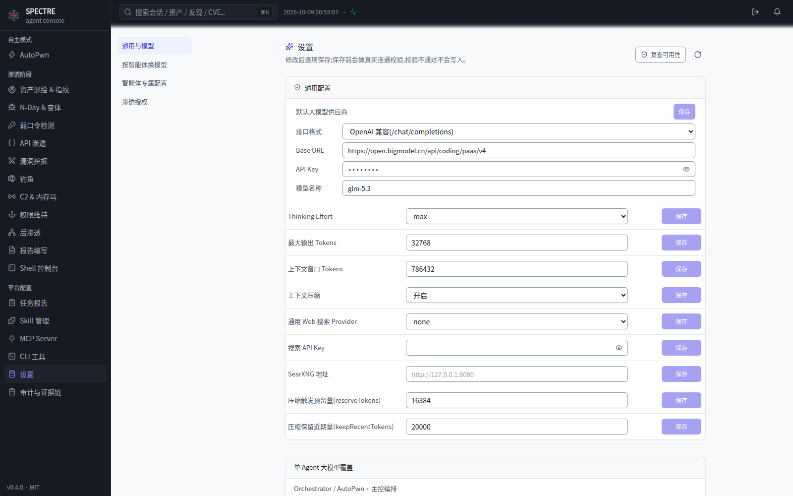

<div align="center">


# SPECTRE

### 资产测绘 → 凭据爆破 → 越权矩阵 → nday 利用链 → 内网横向, 11 席智能体红队并行推进

**多智能体渗透测试平台** —— 漏洞发现与判定分离(每条线索由独立席位复核后才落账), 全程审计可回放

[](https://github.com/lalalala5678/spectre/stargazers)

[](./LICENSE)
[](https://github.com/lalalala5678/spectre/releases)
[](#测试)
[](./deploy/README.md)

[English](./README_EN.md) | [中文文档](./README.md)


*编排席位(AutoPwn)作战视图 —— 左侧为战役时间线, 右侧为工具调用详情。每个席位都有同款界面。*

</div>

---

## 为什么是 SPECTRE

输入目标后, recon 测绘、weakcred 爆破、api 铺越权矩阵、exploit 构造利用链、nday 对账 CVE 并行推进, 最后交付一份带证据链、POC、已验证无漏洞项清单的终报。

**发现与判定分离。** 发现漏洞的席位和判定漏洞的席位是分开的: 复核席位复现证据、读全文、对照库内, 成立才写入漏洞库(下文称"落账"), 重复则合并, 不成立驳回并写明理由。开发期间的实战里它驳回过自己席位的误报。

**两种实战。** 平台开发期间对五个公开靶场跑了全流程战役(116 项); 随后 24 小时内对 52 所高校完成 52 场渗透战役, 产出 119 项漏洞(8 critical / 28 high / 47 medium / 36 low), 平均每 28 分钟收官一所。全部产出在情报库中逐条可查: POC、证据链、复核记录、修订历史。

**中断恢复的边界。** 会话、事件、总线每变异先落盘(WAL); 部署重启先排空在飞回合再退出; 智能体回合被腰斩后自动从断点续跑; 模型接口限速自动退避重试。**能恢复**: 全部会话记录与已落账产出。**不能恢复**: 被腰斩回合中未返回结果的工具调用(模型会被告知腰斩, 自行决定重试)。每条机制的由来见[可靠性工程](#可靠性工程)。

**模型接入。** OpenAI 兼容 / Anthropic / Gemini 三种线制, 控制台四字段配置, 保存前真实探测连通; 默认模型之上可按席位覆盖。

## 实战战绩

### EduSRC 教育行业实战

**24 小时 × 52 所高校 × 119 项漏洞**——资产测绘→指纹→验证→危害补强→独立复核落账, 平均每 28 分钟收官一所高校。

| 维度 | 数据 |
|---|---|
| 战役 | **24 小时 52 所高校**(场均 2.3 项; 最严重战果: 一次请求读取某双一流高校 **8394 名教职工敏感档案**) |
| 发现 | **119 项**: **critical×8** / high×28 / medium×47 / low×36 |
| 攻击纵深 | 某双一流高校被完整打穿: 统一认证无验证码爆破枚举 1.4 万学号→命中学生弱口令→同一凭据登录深信服 VPN→复现开源客户端协议建立 L3 隧道绕过网关 ACL→13.7 万次教师工号字典命中教师账号→以教师身份调用科研管理系统越权接口, 一次请求拖出全库 8394 人档案, 最终拿到含身份证号与加盐口令哈希的完整数据集 |

**代表发现**(按攻击面):

- **统一身份认证族**: 无验证码枚举爆破→管理员弱口令→SSO 全校通行(critical); 记住密码 cookie 明文等价存储; 工号格式从泄露的用户树直接提取
- **OA/协同办公族**: 泛微 e-cology VerifyQuickLogin 未授权管理员接管(critical); 自研 PHP 邮箱登录页发现**第三方挂马存续**(critical, 完整逆向窃密载荷链: 隐藏 iframe→DES 外传引擎→跨站身份窃取)
- **开发残留后门**: 学生就业平台生产环境暴露 dev-login, POST 已知 netId 免密换 system_admin JWT(critical); 同平台 IDM 导出全量教职工 PII(critical)
- **科研计算族**: HPC 门户任意路径文件写入(high, 写入→执行链实证不可达如实降档)/水平越权读全院作业台账/无过滤全量账号树; 实验室安全系统学生 JWT 垂直越权
- **RCE**: 可视化平台未授权命令注入(critical, 良性命令回显即停)
- **网关与密钥**: WebVPN 出厂默认 URL 重写密钥未修改(密钥明文内嵌每个未授权响应, 跨校同族默认值互证)→白名单主机零认证代理; SSL VPN 废弃 TLS+1024bit 弱密钥
- **业务系统族**: ACM/OJ 提交者真实 IP 泄露+组题越权下载; 图书馆 SaaS 管理接口未授权; 招生/就业/财务系统前端硬编码 AES 密钥、验证码服务端零校验、XFF 伪造绕过锁定

| 战役 | 目标栈 | 发现 | 亮点 |
|---|---|---|---|
| crAPI v1.1.5 | Spring / Node / Mongo / PG | **30 项**(7 critical) | SQL 注入读取全库; 默认数据库凭据直连全部数据存储; 5 条端到端利用链(入口→凭据→数据) |
| WebGoat 8 | Java / Spring | **29 项** | JWT 签名算法混淆伪造管理员会话; XXE 读取服务器文件; SQL 注入提取全表 |
| vAPI | PHP / MySQL, OWASP API Top10 | **19 项** | 登录 SQL 注入绕过认证; API Token 离线伪造后可调用全部管理接口 |
| Juice Shop 20 | Node / Angular | **22 项**(3 critical) | 反序列化从入口到命令执行实现 RCE |
| DVWA | PHP 经典 | **16 项** | 命令注入与文件上传双路径拿下 webshell(命令执行), 权限维持含注册-执行-审计全流程 |

**合计 116 项。** 一份脱敏终报样例: [docs/samples/sample-report.md](docs/samples/sample-report.md)

## 界面一览

### 🪖 智能体作战视图

每个席位(编排/测绘/爆破/API/利用/……)都有独立会话界面: 左侧作战时间线(消息、工具调用、思考过程), 右侧详情面板。


### 📋 漏洞与报告面板

全部产出进入 append-only 情报库: 漏洞正本带 severity/发现者/修订链, 任务报告带状态。支持全文检索与分页。



### 🔗 审计与证据链

每一次命令、每一次工具调用、每一个事件都可回溯——这是每一条战果的举证基础。



### 🐚 Shell 控制台

渗透过程中注册的命令通道(webshell/植入)统一管理: 状态、有效期、执行审计。带外回调验证(OOB): 回调落盘为只读挂载, 沙箱内可直接读取实收结果。



### ⚙️ 运行时配置

大模型四字段配置(保存前真实探测)、数据源凭据——全部在控制台完成, 不改代码不改环境变量。



## 架构

```
┌─ console (React) ── 网关 (Python, 会话终结+TLS) ── agent-runtime (Node, :8090)
│                                                    ├─ 11 业务席位 + 3 配置席位 (pi-agent-core)
│                                                    ├─ MCP 情报源: fofa/quake/hunter/zoomeye/
│                                                    │  censys/shodan/github/cse/ipinfo/threatbook
│                                                    └─ Docker 沙箱: nuclei/hydra/nmap/fscan,
│                                                       安装账本化, 容器重建自动重放
├─ Temporal 工作流 (:7233) ── 战役调度 / 断点续跑 / 收尾对账
└─ OOB 收集器 (:19999) ── 带外回调验证, 落盘只读挂 /oob/, 沙箱直读实收
```

<details>
<summary><b>席位一览与配置隔离</b></summary>

| 席位 | 职责 | | 席位 | 职责 |
|---|---|---|---|---|
| autopwn | 编排/调度/对账 | | phish | 钓鱼模板与凭据回收 |
| recon | 测绘: 端口/路由/拓扑 | | c2 | 命令通道注册与生命周期 |
| nday | CVE 对账/变体绕过 | | persistence | 权限维持/拟态伪装 |
| weakcred | 爆破/凭据复用/喷洒 | | postex | 取证/横向面测绘 |
| api | 越权矩阵/批量赋值/JWT | | report | 独立复核: 立账/合并/驳回 |
| exploit | 漏洞挖掘/利用链 | | 配置智能体×3 | skill/mcp/cli 配置独占 |

三个配置智能体持有全部配置工具, 业务席位不接触配置类提示词(架构边界, 见席位表)。

</details>

### 技术选型

- **pi-agent-core 做单席位骨架, 零修改。** 平台在其上做适配层, 逐项对齐官方契约(FileError 码表 / ShellOutputView / TruncationResult), 框架升级不破坏适配。
- **Temporal 做编排, 不是自建任务队列。** 战役是持久化工作流: 席位中断可续跑、收尾自动对账、系统代拟的报告会被真实终报自动作废——这些语义在裸进程模型里需要重造。
- **WAL 预写日志, 不信任内存。** 会话、事件、总线每变异先落盘再生效; 重启从 WAL 重放, 零丢失。

## 可靠性工程

每一条对应一类真实事故, 修复后在后续战役中持续验证:

| 事故形态 | 机制 |
|---|---|
| 部署重启击杀流式回合(46 秒窗口铁证) | SIGTERM 优雅停机: 排空在飞回合再封存, 上限 110s |
| 进程崩溃/断电腰斩回合 | WAL 重放后检测腰斩形态(工具批完成但零产出), 自动注入续跑 |
| 模型接口 429/网络抖动 | 45-60s 退避自动重试, 记账类消息不再随限速蒸发 |
| 工作流长等待假死(三连 5 分钟误判) | 单次长挂改 60s 轮询探测, 根除传输层超时误报 |
| 重复落账/漏账 | 同文幂等 + 修订链 append-only, 重复自动合并 |

## 快速开始

```bash
git clone https://github.com/lalalala5678/spectre && cd spectre
sudo bash deploy/setup.sh    # 带域名: sudo bash deploy/setup.sh your.domain.com
```

一条命令完成: 依赖构建、admin 建号、systemd 服务、TLS。打开控制台, 配置任意 OpenAI 兼容模型, 输入目标开始。

> ⚠️ 一键脚本整机独占(8090/8081/443 + /etc/spectre); 共享机走下方手工路径。

<details>
<summary><b>手工部署</b>(共享机 / 排障 / 定制)</summary>

```bash
# ① 后端 (Node ≥ 22)
cd backend && cp .env.example .env   # INTERNAL_TOKEN 填随机串
SPECTRE_DATA_DIR=/tmp/spectre-data npm i && npm test
SPECTRE_DATA_DIR=/tmp/spectre-data node agent-runtime.mjs

# ② 前端 (同 Node 版本)
cd ../console && npm i && npm run build

# ③ 网关 (纯 stdlib, 零第三方依赖)
cd ../gateway
SPECTRE_AUTH_DIR=/tmp/spectre-auth PASS='<密码>' python3 spectre-passwd.py add admin
INTERNAL_TOKEN=<同①> SPECTRE_DATA_DIR=/tmp/spectre-data \
  SPECTRE_AUTH_DIR=/tmp/spectre-auth python3 server.py
```

打开 `http://127.0.0.1:8081/spectre/`, admin 登录, 设置页配模型。

</details>

## 测试

```bash
cd backend && npm test    # 67 用例: 互斥去重/会话生命周期/修订链/幂等/行数锁
```

## FAQ

**AI 找的漏洞可信吗?** 每条线索由独立席位复核后才落账(见上文"发现与判定分离"); 落账条目带 POC 与证据链, 可逐条复验。

**崩了/限速/重启怎么办?** 见[可靠性工程](#可靠性工程)的五类事故与对应机制。

**能接自己的模型吗?** 见上文"模型接入"。

## 贡献与支持

- Bug / 功能建议: [提 Issue](https://github.com/lalalala5678/spectre/issues), 附复现步骤与日志片段
- PR: 触及核心文件请同步 `docs/ARCHITECTURE.md` 行数表(测试会锁), 跑通 `cd backend && npm test`
- 安全披露: 走私下渠道, 勿在公开 issue 贴未脱敏凭据

## License

[MIT](./LICENSE) © 2026 lalalala5678

---

合规责任在使用者。
